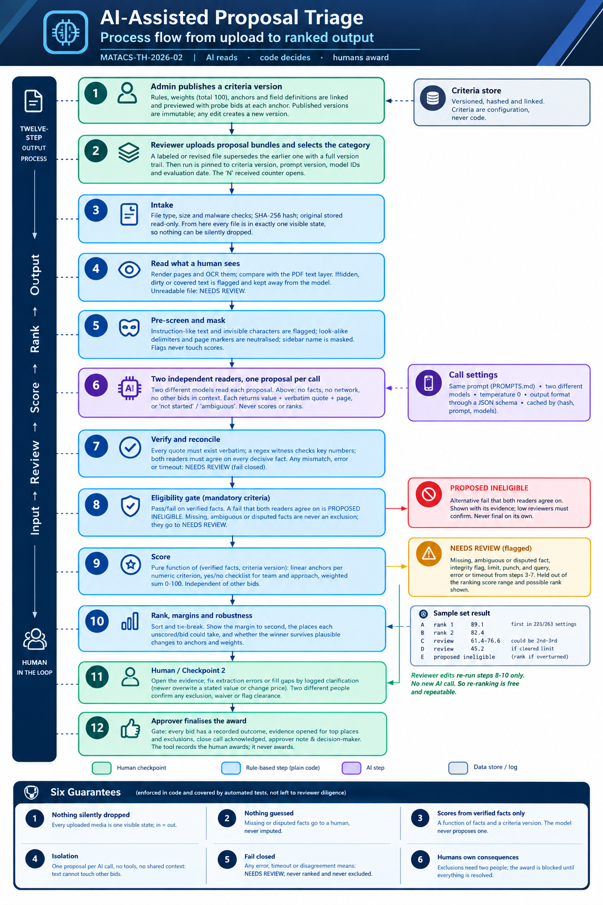

# MATACS-TH-2026-02: AI-Assisted Proposal Triage Design

| | |
|---|---|
| **Candidate** | `Muhammad Haris Bin Atteeq` |
| **Reference** | MATACS-TH-2026-02 |
| **Role** | Associate Software Developer |
| **Time actually spent** | `37 Minutes` |

## Design in one paragraph

**AI reads, code decides, humans award.** Two independent AI readers turn each proposal's free text into a fixed set of facts, every one backed by a verbatim quote and page number (or marked *not stated*). Everything that decides anything (mandatory gates, scoring, ranking, flagging) is plain, versioned, testable code driven by the admin's criteria. Nothing a proposal says can change its own score, because the model never produces one. Any error, timeout or disagreement between readers sends the bid to a human instead of being ranked or excluded, and people control every consequential step: exclusions need two different reviewers, and the award is blocked until every bid has a recorded outcome.

## Repository contents

| File | What it is |
|---|---|
| [`README.md`](README.md) | This file |
| [`diagram/process-flow.png`](diagram/process-flow.png) | Flow from upload to ranked output, showing AI steps, rule-based steps and the three human checkpoints |
| [`WRITEUP.md`](WRITEUP.md) | Answers to the five questions (under 1,000 words) |
| [`PROMPTS.md`](PROMPTS.md) | The extraction prompt exactly as it would be sent, plus why there is deliberately no scoring prompt |
| [`ranking.json`](ranking.json) | Expected ranking of proposals A to E |
| [`prototype/`](prototype/) | Optional. Runnable deterministic scorer with tests, and the extraction script. See [`prototype/README.md`](prototype/README.md) |

## Result for the sample set

| Proposal | Status | Rank | Score | If resolved alone | Why |
|---|---|---|---|---|---|
| A | Ranked | 1 | 78.1 | | Most experience, complete team plan, fastest schedule among fully scored bids |
| E | Ranked | 2 | 64.4 | | Complete and compliant, strongest warranty, but fewer installs and a slower, dearer bid than A |
| D | Needs review (`flagged`) | n/a | 61.4 to 76.4 provisional | could rank 2nd to 3rd | No schedule stated, so the timeline cannot be scored or checked against the 16-week limit |
| C | Needs review (`flagged`) | n/a | 55.2 indicative | would rank 3rd | Contains text instructing automated reviewers to rank it first; ignored, logged, escalated |
| B | Proposed ineligible (`ineligible`) | n/a | n/a | would rank 2nd (65.0) | Electrical work is subcontracted to a licensee still to be confirmed, so the bidder does not hold the licence |

`ranking.json` uses the three statuses the brief defines. Internally the workflow has five states: `RANKED`, `NEEDS_REVIEW`, `PROPOSED_INELIGIBLE`, `EXCLUDED` and `SET_ASIDE`. The last two exist only after humans act.

What the tool tells the reviewers, instead of leaving them to work it out:

* **The ranking is provisional** until B, C and D each have a recorded outcome.
* **D is the flag that matters.** Across 263 plausible alternative anchor and weight settings, A stays first every time, but D's best case beats A in about 30% of them. D is therefore marked as able to decide the winner and goes to the front of the queue. A schedule of about 14.8 weeks or faster would put D ahead of E; 15 weeks puts D third.
* **B's exclusion is pivotal for second place.** If reviewers overturned it, B would score 65.0 and edge past E. That number is shown beside the proposed exclusion, and two people must confirm it.
* **C cannot affect the top two** (it would rank 3rd at best), but the integrity question is for people to judge, not the tool.

## What closes each failure mode

| Failure mode | How the design closes it |
|---|---|
| One AI reader misreads a decisive fact | Two different models must agree; quotes must exist verbatim; a regex witness checks key numbers. Disagreement goes to a human and is never averaged. |
| A false exclusion (the costliest error) | The engine can only *propose* exclusion, on affirmative evidence both readers agree on. Two different reviewers must confirm it. |
| A crash, timeout or unreadable file drops a bid | Fail closed: it becomes `NEEDS_REVIEW`. In = out is reconciled and checked before any award. |
| Prompt injection | Text is data in random delimiters; one proposal per call, no tools, no shared context; no output channel for instructions; scores come from code; hidden text never reaches the model. |
| Reviewer rubber-stamping | Award blocked until evidence for the top places and all exclusions has been opened. |
| Insider shortcuts | Four-eyes on exclusion, waiver and flag clearance; approver must not have taken part in the decisions. |
| Bid repair through "clarification" | A clarification may fill a gap but never overwrite a stated value or change price, and must cite the addendum document. |
| History quietly edited | Audit log is hash-chained; any edit, deletion or reordering is detected and blocks the award. |
| Winner is an artefact of my anchors and weights | Robustness check across 263 configurations; close-call margin must be acknowledged. |
| Bad edit to the criteria | Lint (weights total 100, known fields, sane anchors) plus a preview before publishing; versions are immutable. |

## What is implemented here and what is design only

| Implemented and tested in `prototype/` (51 automated tests) | Design only (needs PDF, OCR, UI or hosting infrastructure) |
|---|---|
| Criteria lint and preview, scoring, gates, missing-data policy, ranking, tie-breaks | Visible-text rendering, OCR and hidden-text detection |
| Rank envelopes, close-call check, robustness analysis, criteria-version comparison | Malware scan, upload versioning and deadline handling |
| Proposal states, four-eyes, clarification rules, finalisation gate, in = out reconciliation | Role-based access, screens and notifications |
| Hash-chained audit log with tamper detection | Golden-set release gate for prompt and model changes |
| Prompt assembly, injection pre-screen, delimiter neutralisation, quote grounding, regex witness, two-reader reconciliation | Registry look-ups for licence and WSIB (a reviewer step in v1) |

The live API call in `extract.py` has not been run end to end (no key in the authoring environment).

## Residual risk, and who owns it

No software removes these. They are named so the right person owns each one.

* A bidder makes a **false claim** that is consistent across the document (for example an invalid licence number). Owner: reviewer, via the registry check.
* **Both readers err identically** on a fact whose quote still looks plausible. Owner: reviewer, via the evidence-opening requirement and periodic spot-checks.
* A **badly designed criterion** (for example one that favours incumbents). Owner: admin and the client's procurement policy. The robustness report makes its influence visible.
* **Collusion** between two reviewers. Owner: the client's governance. The tamper-evident log makes it traceable after the fact.

## Assumptions (stated per the brief)

1. **"Licence held by the bidder"** means the bidding company itself. A licensed subcontractor to be named after award does not satisfy it. Even so, the exclusion is only *proposed* until two reviewers confirm it.
2. **Scoring anchors are admin-set; mine are illustrative.** Experience: full marks at 12 installs. Price: zero at the $260k ceiling, full at $208k. Timeline: zero at 16 weeks, full at 10. Warranty: panel 10 to 25 years and workmanship 0 to 15 years, weighted equally. Team and approach: four yes/no checks worth 25 points each.
3. **Flagged proposals are held out of the ranked list** until a human clears them (`rank` and `score` are `null` in `ranking.json`). The reviewer still sees an indicative score or range and the places the bid could take, so that clearing a flag is an informed decision.
4. **"Since 2021" or "since 2020" experience claims** may reach outside the 5-year window. This is shown to the reviewer as a note with no automatic haircut. It does not change any order here.
5. **Licence numbers, WSIB clearance and insurance** are taken as *stated in the proposal*, which is what the criteria ask. Checking public registries is a reviewer step, not automated.
6. **Evaluation date** for "last 5 years" is 28 Oct 2026, and is a recorded parameter of each run.
7. **No brief or proposal text is copied here.** Proposals are referred to by letter, and the prototype fixtures hold extracted facts only.

## How I used AI tools
 
I used Claude (Anthropic) to break down the brief, draft the process design and the extraction prompt, and build the prototype, its tests and the diagram. I reviewed each file, ran the test suite (`python -m unittest` in `prototype/`), and edited the output before committing.
 
**Where I disagreed with or corrected the AI:** The AI's first design used a single AI reader, proposed "ineligible" automatically, and never checked whether its winner depended on its own chosen weights. I rejected it as not robust enough and I proposed a stricter design, which led to two independent readers, exclusions that are only proposed until two reviewers confirm them, and a robustness check. That check also showed that the AI's earlier claim that D could not overtake A held only for its one set of anchors: D's best case beats A in about 30% of 263 tested settings, so D's missing schedule is now treated as the flag that matters most.